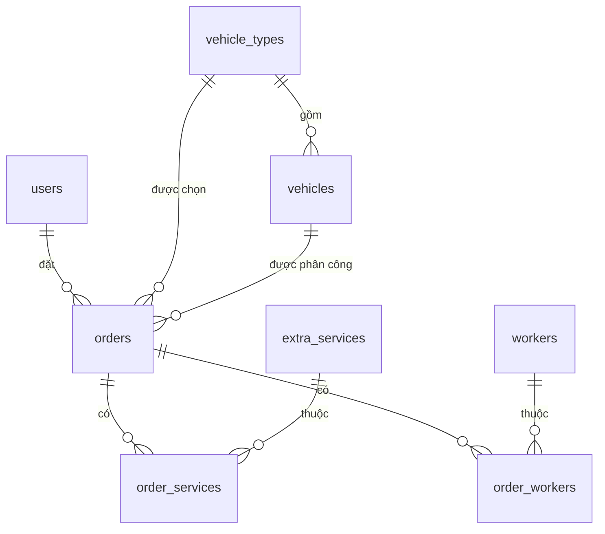

# Thiết kế cơ sở dữ liệu

CSDL: MySQL, tên database `moving_service`. Gồm 8 bảng: 6 bảng chính và 2 bảng nối.

Các bảng do Hibernate tự tạo từ các lớp entity trong backend khi chạy lần đầu, không cần viết script SQL.

## 1. Sơ đồ quan hệ

| Quan hệ | Kiểu | Ý nghĩa |
|---|---|---|
| `users` – `orders` | 1 – nhiều | Một khách hàng đặt nhiều đơn |
| `vehicle_types` – `vehicles` | 1 – nhiều | Một loại xe có nhiều xe |
| `vehicle_types` – `orders` | 1 – nhiều | Mỗi đơn chọn một loại xe |
| `vehicles` – `orders` | 1 – nhiều | Mỗi đơn được phân công một xe |
| `orders` – `extra_services` | nhiều – nhiều | Qua bảng nối `order_services` |
| `orders` – `workers` | nhiều – nhiều | Qua bảng nối `order_workers` |

## 2. Chi tiết từng bảng

Ký hiệu: PK là khóa chính, FK là khóa ngoại, UQ là duy nhất.

### 2.1. `users`: tài khoản

Khách hàng, nhân viên và admin dùng chung một bảng, phân biệt bằng cột `role`.

| Cột | Kiểu | Bắt buộc | Ràng buộc | Mô tả |
|---|---|---|---|---|
| `id` | BIGINT | Có | PK, tự tăng | Mã tài khoản |
| `full_name` | VARCHAR(100) | Có | | Họ tên |
| `email` | VARCHAR(100) | Có | UQ | Email, dùng để đăng nhập |
| `phone` | VARCHAR(15) | Có | | Số điện thoại |
| `password_hash` | VARCHAR(255) | Có | | Mật khẩu đã mã hóa BCrypt |
| `role` | VARCHAR(20) | Có | | `CUSTOMER`, `STAFF` hoặc `ADMIN` |
| `active` | BIT(1) | Có | Mặc định 1 | 0 là tài khoản bị khóa |
| `created_at` | DATETIME | Có | | Thời điểm tạo |

### 2.2. `vehicle_types`: loại xe và đơn giá

| Cột | Kiểu | Bắt buộc | Ràng buộc | Mô tả |
|---|---|---|---|---|
| `id` | BIGINT | Có | PK, tự tăng | Mã loại xe |
| `name` | VARCHAR(100) | Có | UQ | Tên loại xe, ví dụ "Xe tải 1 tấn" |
| `capacity_kg` | INT | Có | | Tải trọng, tính bằng kg |
| `base_price` | DECIMAL(12,0) | Có | | Giá mở cửa (VND) |
| `price_per_km` | DECIMAL(12,0) | Có | | Giá mỗi km (VND) |
| `active` | BIT(1) | Có | Mặc định 1 | 0 là ngừng cung cấp, khách không chọn được |

### 2.3. `extra_services`: dịch vụ kèm theo

| Cột | Kiểu | Bắt buộc | Ràng buộc | Mô tả |
|---|---|---|---|---|
| `id` | BIGINT | Có | PK, tự tăng | Mã dịch vụ |
| `name` | VARCHAR(100) | Có | UQ | Tên dịch vụ, ví dụ "Đóng gói đồ đạc" |
| `description` | VARCHAR(500) | Không | | Mô tả |
| `price` | DECIMAL(12,0) | Có | | Giá (VND) |
| `active` | BIT(1) | Có | Mặc định 1 | 0 là ngừng cung cấp |

### 2.4. `vehicles`: xe

| Cột | Kiểu | Bắt buộc | Ràng buộc | Mô tả |
|---|---|---|---|---|
| `id` | BIGINT | Có | PK, tự tăng | Mã xe |
| `license_plate` | VARCHAR(20) | Có | UQ | Biển số |
| `vehicle_type_id` | BIGINT | Có | FK → `vehicle_types.id` | Loại xe |
| `status` | VARCHAR(20) | Có | Mặc định `AVAILABLE` | `AVAILABLE` (rảnh), `BUSY` (đang chạy đơn), `MAINTENANCE` (bảo dưỡng hoặc ngừng dùng) |

### 2.5. `workers`: đội vận chuyển

Tài xế và nhân viên bốc xếp. Không có tài khoản đăng nhập.

| Cột | Kiểu | Bắt buộc | Ràng buộc | Mô tả |
|---|---|---|---|---|
| `id` | BIGINT | Có | PK, tự tăng | Mã nhân sự |
| `full_name` | VARCHAR(100) | Có | | Họ tên |
| `phone` | VARCHAR(15) | Có | | Số điện thoại |
| `position` | VARCHAR(20) | Có | | `DRIVER` (tài xế) hoặc `PORTER` (bốc xếp) |
| `status` | VARCHAR(20) | Có | Mặc định `AVAILABLE` | `AVAILABLE` (rảnh), `BUSY` (đang làm đơn), `INACTIVE` (đã nghỉ việc) |

### 2.6. `orders`: đơn chuyển nhà

| Cột | Kiểu | Bắt buộc | Ràng buộc | Mô tả |
|---|---|---|---|---|
| `id` | BIGINT | Có | PK, tự tăng | Mã đơn |
| `customer_id` | BIGINT | Có | FK → `users.id` | Khách đặt đơn |
| `pickup_address` | VARCHAR(255) | Có | | Địa chỉ nơi đi |
| `delivery_address` | VARCHAR(255) | Có | | Địa chỉ nơi đến |
| `moving_time` | DATETIME | Có | | Ngày giờ chuyển |
| `distance_km` | DOUBLE | Có | | Quãng đường (km), khách tự nhập |
| `pickup_floor` | INT | Có | | Số tầng nơi đi, tầng trệt là 0 |
| `delivery_floor` | INT | Có | | Số tầng nơi đến, tầng trệt là 0 |
| `vehicle_type_id` | BIGINT | Có | FK → `vehicle_types.id` | Loại xe khách chọn |
| `note` | VARCHAR(1000) | Không | | Ghi chú của khách |
| `estimated_price` | DECIMAL(12,0) | Có | | Giá ước tính, hệ thống tính khi đặt |
| `final_price` | DECIMAL(12,0) | Không | | Giá chốt, nhân viên nhập khi xác nhận |
| `status` | VARCHAR(20) | Có | Mặc định `PENDING` | Trạng thái đơn, xem mục 3 |
| `payment_status` | VARCHAR(20) | Có | Mặc định `UNPAID` | Trạng thái thanh toán, xem mục 3 |
| `vehicle_id` | BIGINT | Không | FK → `vehicles.id` | Xe được phân công, có sau khi xác nhận |
| `cancel_reason` | VARCHAR(500) | Không | | Lý do hủy |
| `created_at` | DATETIME | Có | | Thời điểm đặt |

### 2.7. `order_services`: dịch vụ kèm theo của đơn

| Cột | Kiểu | Bắt buộc | Ràng buộc | Mô tả |
|---|---|---|---|---|
| `order_id` | BIGINT | Có | PK, FK → `orders.id` | Đơn |
| `extra_service_id` | BIGINT | Có | PK, FK → `extra_services.id` | Dịch vụ kèm theo |

### 2.8. `order_workers`: nhân sự được phân công cho đơn

| Cột | Kiểu | Bắt buộc | Ràng buộc | Mô tả |
|---|---|---|---|---|
| `order_id` | BIGINT | Có | PK, FK → `orders.id` | Đơn |
| `worker_id` | BIGINT | Có | PK, FK → `workers.id` | Nhân sự |

## 3. Giá trị của các cột trạng thái

| Bảng.cột | Giá trị | Ý nghĩa |
|---|---|---|
| `users.role` | `CUSTOMER` | Khách hàng |
| | `STAFF` | Nhân viên |
| | `ADMIN` | Quản trị viên |
| `orders.status` | `PENDING` | Chờ xác nhận |
| | `CONFIRMED` | Đã xác nhận |
| | `IN_PROGRESS` | Đang thực hiện |
| | `COMPLETED` | Hoàn thành |
| | `CANCELLED` | Đã hủy |
| `orders.payment_status` | `UNPAID` | Chưa thanh toán |
| | `DEPOSITED` | Đã cọc |
| | `PAID` | Đã thanh toán |
| `vehicles.status` | `AVAILABLE` | Rảnh |
| | `BUSY` | Đang chạy đơn |
| | `MAINTENANCE` | Bảo dưỡng hoặc ngừng dùng |
| `workers.position` | `DRIVER` | Tài xế |
| | `PORTER` | Bốc xếp |
| `workers.status` | `AVAILABLE` | Rảnh |
| | `BUSY` | Đang làm đơn |
| | `INACTIVE` | Đã nghỉ việc |

## 4. Quy tắc dữ liệu

| # | Quy tắc |
|---|---|
| 1 | Loại xe, dịch vụ kèm theo, xe và nhân sự đã xuất hiện trong ít nhất một đơn thì không xóa được. Khi đó chuyển `active` về 0 (loại xe, dịch vụ), hoặc chuyển trạng thái sang `MAINTENANCE` (xe), `INACTIVE` (nhân sự). |
| 2 | Tài khoản không bị xóa, chỉ bị khóa bằng `active = 0`. |
| 3 | Số tiền lưu bằng VND, không có phần thập phân. |
| 4 | `final_price`, `vehicle_id` và các dòng `order_workers` chỉ có từ khi đơn được xác nhận. |
| 5 | Xe và nhân sự chuyển `BUSY` khi đơn bắt đầu thực hiện, về `AVAILABLE` khi đơn hoàn thành. |
