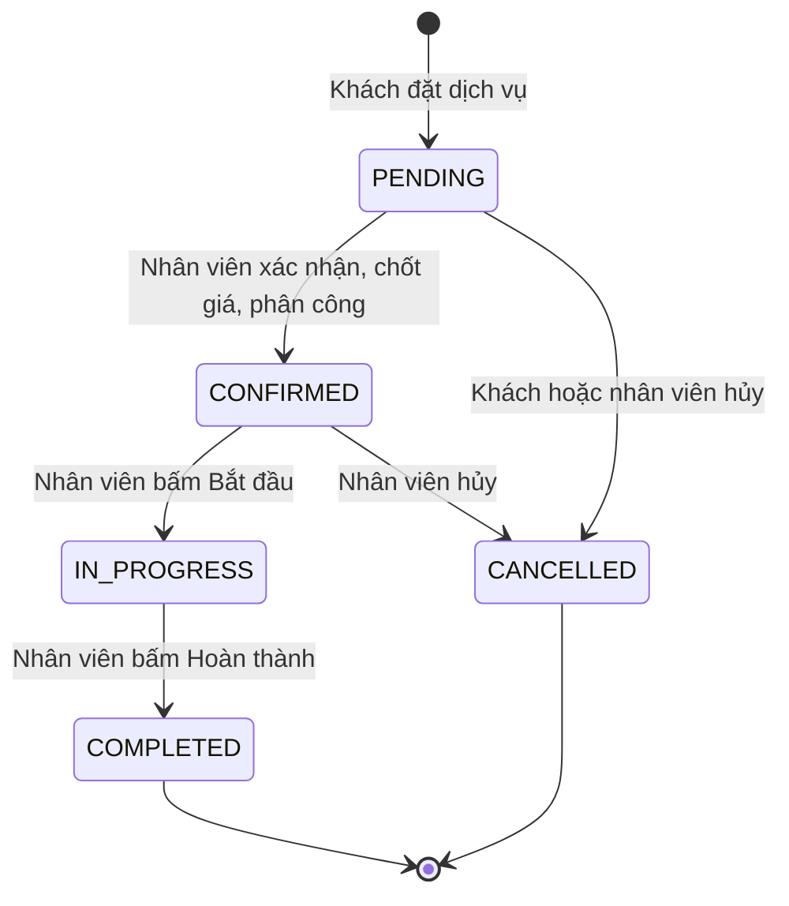
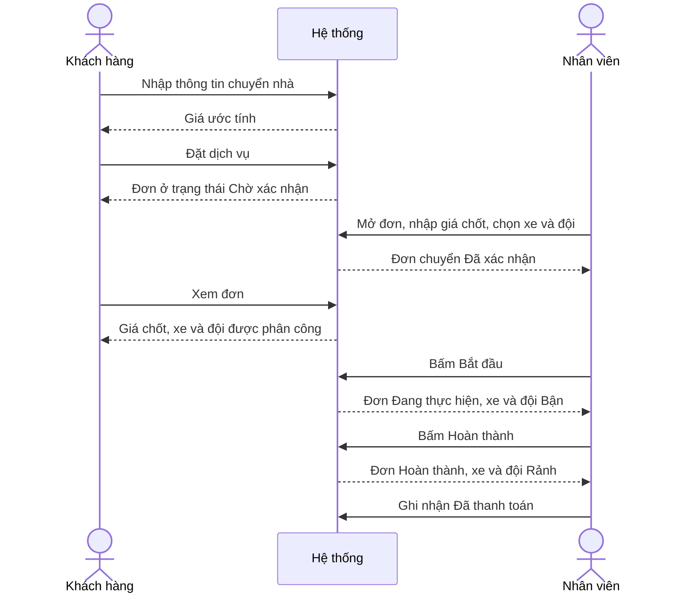

# Các luồng nghiệp vụ chính

Tài liệu mô tả 9 luồng chính của hệ thống. Mỗi luồng gồm điều kiện trước, các bước của luồng chuẩn (happy case), kết quả và các ngoại lệ.

Cột "CN" là số chức năng trong [chuc-nang.md](chuc-nang.md), cột "API" là số API trong [api.md](api.md).

| # | Luồng | Ai thực hiện | CN |
|---|---|---|---|
| 1 | Đăng ký và đăng nhập | Tất cả | 1, 2, 3 |
| 2 | Đặt dịch vụ | Khách hàng | 5, 6 |
| 3 | Xác nhận và phân công | Nhân viên, Admin | 9, 10 |
| 4 | Thực hiện và hoàn thành | Nhân viên, Admin | 11 |
| 5 | Ghi nhận thanh toán | Nhân viên, Admin | 12 |
| 6 | Hủy đơn | Khách hàng, Nhân viên, Admin | 8, 13 |
| 7 | Quản lý danh mục | Admin | 14, 15, 16, 17 |
| 8 | Quản lý tài khoản nhân viên | Admin | 18 |
| 9 | Xem thống kê | Admin | 19 |

## Tổng quan: vòng đời của một đơn

| Trạng thái | Tên hiển thị | Ai chuyển tới | Việc xảy ra kèm theo |
|---|---|---|---|
| `PENDING` | Chờ xác nhận | Khách hàng | Hệ thống tính và lưu giá ước tính |
| `CONFIRMED` | Đã xác nhận | Nhân viên | Lưu giá chốt, xe và đội được phân công |
| `IN_PROGRESS` | Đang thực hiện | Nhân viên | Xe và đội chuyển sang Bận |
| `COMPLETED` | Hoàn thành | Nhân viên | Xe và đội trở về Rảnh |
| `CANCELLED` | Đã hủy | Khách hàng hoặc nhân viên | Lưu lý do hủy |

Luồng đầu cuối của một đơn thành công:

## Luồng 1: Đăng ký và đăng nhập

**Điều kiện trước:** người dùng chưa đăng nhập.

| Bước | Người thực hiện | Hành động | Hệ thống xử lý | API |
|---|---|---|---|---|
| 1 | Khách | Mở trang Đăng ký, nhập họ tên, email, SĐT, mật khẩu | Kiểm tra định dạng từng trường | |
| 2 | Khách | Bấm Đăng ký | Kiểm tra email chưa dùng, băm mật khẩu, tạo tài khoản vai trò Khách hàng, cấp token | 1 |
| 3 | Hệ thống | | Lưu token, chuyển khách vào trang chủ ở trạng thái đã đăng nhập | |
| 4 | Người dùng | Ở lần sau: mở trang Đăng nhập, nhập email và mật khẩu | Kiểm tra email, mật khẩu, tài khoản không bị khóa, cấp token | 2 |
| 5 | Hệ thống | | Chuyển tới trang chủ (khách) hoặc trang quản trị (nhân viên, admin) | |
| 6 | Người dùng | Bấm Đăng xuất | Xóa token, về trang Đăng nhập | |

**Kết quả:** người dùng đã đăng nhập, mỗi request sau đó tự gửi kèm token.

| Ngoại lệ | Hệ thống phản hồi |
|---|---|
| Email đã được dùng | Báo "Email đã được sử dụng", không tạo tài khoản |
| Dữ liệu sai định dạng | Báo lỗi ở trường tương ứng, không gửi lên server |
| Sai email hoặc mật khẩu, hoặc tài khoản bị khóa | Báo "Email hoặc mật khẩu không đúng" |
| Token hết hạn khi đang dùng | Tự đăng xuất, về trang Đăng nhập |

## Luồng 2: Đặt dịch vụ

**Điều kiện trước:** khách đã đăng nhập; có ít nhất một loại xe đang cung cấp.

| Bước | Người thực hiện | Hành động | Hệ thống xử lý | API |
|---|---|---|---|---|
| 1 | Khách | Mở trang chủ xem bảng giá | Trả về loại xe và dịch vụ kèm theo đang cung cấp | 6, 7 |
| 2 | Khách | Mở trang Đặt dịch vụ, nhập địa chỉ đi, địa chỉ đến, ngày giờ chuyển, số km, số tầng hai đầu | Kiểm tra định dạng từng trường | |
| 3 | Khách | Chọn loại xe và các dịch vụ kèm theo | Tính giá ước tính theo công thức, trả về từng khoản và tổng | 8 |
| 4 | Khách | Xem giá ước tính, nhập ghi chú nếu cần, bấm Đặt | Tính lại giá ở server, tạo đơn trạng thái Chờ xác nhận, thanh toán Chưa thanh toán | 9 |
| 5 | Hệ thống | | Chuyển khách tới trang chi tiết đơn vừa tạo | 11 |

**Kết quả:** có một đơn mới ở trạng thái Chờ xác nhận, hiện trong "Đơn của tôi" của khách và trong danh sách đơn của nhân viên.

| Ngoại lệ | Hệ thống phản hồi |
|---|---|
| Ngày giờ chuyển ở quá khứ | Báo lỗi, không tạo đơn |
| Số km bằng 0 hoặc âm, số tầng âm | Báo lỗi, không tạo đơn |
| Loại xe hoặc dịch vụ vừa bị ngừng cung cấp | Báo lỗi, khách chọn lại |

Giá luôn do server tính lại khi tạo đơn; giá hiển thị ở bước 3 chỉ để khách tham khảo.

## Luồng 3: Xác nhận và phân công

**Điều kiện trước:** nhân viên hoặc admin đã đăng nhập; có đơn Chờ xác nhận; có xe và nhân sự đang Rảnh.

| Bước | Người thực hiện | Hành động | Hệ thống xử lý | API |
|---|---|---|---|---|
| 1 | Nhân viên | Mở danh sách đơn, lọc trạng thái Chờ xác nhận | Trả về danh sách đơn, mới nhất trước | 13 |
| 2 | Nhân viên | Mở chi tiết một đơn | Trả về thông tin đơn và giá ước tính | 14 |
| 3 | Nhân viên | Liên hệ khách ngoài hệ thống để thống nhất giá | | |
| 4 | Nhân viên | Nhập giá chốt, chọn một xe rảnh đúng loại và các nhân sự rảnh | Trả về danh sách xe rảnh và nhân sự rảnh | 20, 21 |
| 5 | Nhân viên | Bấm Xác nhận | Kiểm tra đơn còn Chờ xác nhận, xe và nhân sự còn Rảnh; lưu giá chốt, xe, đội; chuyển đơn sang Đã xác nhận | 15 |

**Kết quả:** đơn ở trạng thái Đã xác nhận; khách thấy giá chốt, xe và đội trong chi tiết đơn.

| Ngoại lệ | Hệ thống phản hồi |
|---|---|
| Không chọn nhân sự nào, hoặc giá chốt bằng 0 | Báo lỗi, không xác nhận |
| Xe hoặc nhân sự vừa chuyển sang Bận, Bảo dưỡng hoặc Đã nghỉ | Báo lỗi, nhân viên chọn lại |
| Đơn đã bị khách hủy trong lúc nhân viên đang xem | Báo lỗi, đơn giữ trạng thái Đã hủy |

## Luồng 4: Thực hiện và hoàn thành

**Điều kiện trước:** đơn ở trạng thái Đã xác nhận.

| Bước | Người thực hiện | Hành động | Hệ thống xử lý | API |
|---|---|---|---|---|
| 1 | Nhân viên | Đến ngày chuyển, mở chi tiết đơn, bấm Bắt đầu | Kiểm tra xe và đội của đơn không Bận ở đơn khác; chuyển đơn sang Đang thực hiện; chuyển xe và đội sang Bận | 16 |
| 2 | Đội vận chuyển | Chuyển đồ cho khách (ngoài hệ thống) | | |
| 3 | Nhân viên | Khi đội báo xong, bấm Hoàn thành | Chuyển đơn sang Hoàn thành; chuyển xe và đội về Rảnh | 17 |

**Kết quả:** đơn Hoàn thành; xe và đội sẵn sàng cho đơn khác; đơn được tính vào doanh thu.

| Ngoại lệ | Hệ thống phản hồi |
|---|---|
| Bấm Bắt đầu khi xe hoặc nhân sự của đơn đang Bận ở đơn khác | Báo lỗi, đơn giữ trạng thái Đã xác nhận |
| Bấm Bắt đầu hoặc Hoàn thành khi đơn không ở đúng trạng thái | Báo lỗi, không đổi trạng thái |

## Luồng 5: Ghi nhận thanh toán

**Điều kiện trước:** đơn chưa bị hủy.

| Bước | Người thực hiện | Hành động | Hệ thống xử lý | API |
|---|---|---|---|---|
| 1 | Khách | Trả tiền cọc hoặc trả đủ bằng tiền mặt hay chuyển khoản (ngoài hệ thống) | | |
| 2 | Nhân viên | Mở chi tiết đơn, chọn Đã cọc hoặc Đã thanh toán, bấm Lưu | Cập nhật trạng thái thanh toán của đơn | 19 |
| 3 | Khách | Mở chi tiết đơn | Hiển thị trạng thái thanh toán mới | 11 |

**Kết quả:** trạng thái thanh toán của đơn phản ánh số tiền khách đã trả.

| Ngoại lệ | Hệ thống phản hồi |
|---|---|
| Cập nhật thanh toán cho đơn Đã hủy | Báo lỗi, không cập nhật |

Trạng thái thanh toán độc lập với trạng thái đơn: khách có thể cọc trước khi chuyển và trả đủ sau khi hoàn thành.

## Luồng 6: Hủy đơn

**Điều kiện trước:** đơn chưa bắt đầu thực hiện.

| Bước | Người thực hiện | Hành động | Hệ thống xử lý | API |
|---|---|---|---|---|
| 1a | Khách | Mở đơn đang Chờ xác nhận, bấm Hủy, nhập lý do | Kiểm tra đơn của chính khách và còn Chờ xác nhận; lưu lý do; chuyển đơn sang Đã hủy | 12 |
| 1b | Nhân viên | Mở đơn Chờ xác nhận hoặc Đã xác nhận, bấm Hủy, nhập lý do | Kiểm tra trạng thái; lưu lý do; chuyển đơn sang Đã hủy | 18 |

**Kết quả:** đơn ở trạng thái Đã hủy kèm lý do, không tính vào doanh thu.

| Ngoại lệ | Hệ thống phản hồi |
|---|---|
| Khách hủy đơn đã được xác nhận | Báo lỗi; khách liên hệ nhân viên để hủy |
| Hủy đơn Đang thực hiện hoặc Hoàn thành | Báo lỗi, không hủy |
| Không nhập lý do | Báo lỗi, không hủy |

Xe và đội chỉ chuyển Bận khi đơn bắt đầu thực hiện, nên hủy đơn Đã xác nhận không cần trả lại trạng thái cho xe và đội.

## Luồng 7: Quản lý danh mục

Áp dụng giống nhau cho bốn danh mục: loại xe và đơn giá, dịch vụ kèm theo, xe, đội vận chuyển.

**Điều kiện trước:** admin đã đăng nhập.

| Bước | Người thực hiện | Hành động | Hệ thống xử lý | API |
|---|---|---|---|---|
| 1 | Admin | Mở màn hình danh mục | Trả về toàn bộ danh sách, gồm cả mục đã ngừng | 6, 7, 28, 32 |
| 2 | Admin | Bấm Thêm, nhập thông tin, bấm Lưu | Kiểm tra dữ liệu, kiểm tra không trùng tên hoặc biển số, tạo mục mới | 22, 25, 29, 33 |
| 3 | Admin | Bấm Sửa ở một dòng, đổi thông tin hoặc trạng thái, bấm Lưu | Cập nhật mục | 23, 26, 30, 34 |
| 4 | Admin | Bấm Xóa ở một dòng, xác nhận | Kiểm tra mục chưa được đơn nào dùng, xóa mục | 24, 27, 31, 35 |

**Kết quả:** danh mục được cập nhật; loại xe và dịch vụ mới hiện ngay trong bảng giá, xe và nhân sự mới hiện trong danh sách phân công.

| Ngoại lệ | Hệ thống phản hồi |
|---|---|
| Trùng tên loại xe, tên dịch vụ hoặc biển số | Báo lỗi, không lưu |
| Xóa mục đã có đơn dùng tới | Báo lỗi; admin chuyển mục sang ngừng cung cấp, Bảo dưỡng hoặc Đã nghỉ |

Sửa đơn giá không ảnh hưởng tới các đơn đã đặt, vì giá ước tính và giá chốt đã lưu trong đơn.

## Luồng 8: Quản lý tài khoản nhân viên

**Điều kiện trước:** admin đã đăng nhập.

| Bước | Người thực hiện | Hành động | Hệ thống xử lý | API |
|---|---|---|---|---|
| 1 | Admin | Mở màn hình Tài khoản nhân viên | Trả về danh sách tài khoản vai trò Nhân viên | 36 |
| 2 | Admin | Bấm Thêm, nhập họ tên, email, SĐT, mật khẩu ban đầu, bấm Lưu | Kiểm tra email chưa dùng, tạo tài khoản vai trò Nhân viên | 37 |
| 3 | Nhân viên | Đăng nhập bằng email và mật khẩu ban đầu, đổi mật khẩu ở trang Hồ sơ | Xác thực, chuyển vào trang quản trị | 2, 5 |
| 4 | Admin | Khi nhân viên nghỉ việc: bấm Khóa ở dòng tương ứng | Chuyển tài khoản sang bị khóa | 38 |

**Kết quả:** nhân viên có tài khoản để xử lý đơn; tài khoản bị khóa không đăng nhập được và token đang dùng cũng bị từ chối.

| Ngoại lệ | Hệ thống phản hồi |
|---|---|
| Email đã được dùng | Báo lỗi, không tạo tài khoản |

## Luồng 9: Xem thống kê

**Điều kiện trước:** admin đã đăng nhập.

| Bước | Người thực hiện | Hành động | Hệ thống xử lý | API |
|---|---|---|---|---|
| 1 | Admin | Mở màn hình Thống kê | Mặc định chọn năm hiện tại | |
| 2 | Admin | Chọn năm | Tính doanh thu và số đơn Hoàn thành của từng tháng; đếm số đơn theo từng trạng thái | 39, 40 |
| 3 | Admin | Xem bảng và biểu đồ | | |

**Kết quả:** admin thấy doanh thu 12 tháng và số đơn theo trạng thái của năm đã chọn.

Doanh thu chỉ tính đơn Hoàn thành, lấy theo giá chốt và xếp vào tháng của ngày chuyển. Năm không có đơn thì cả 12 tháng hiển thị 0.
